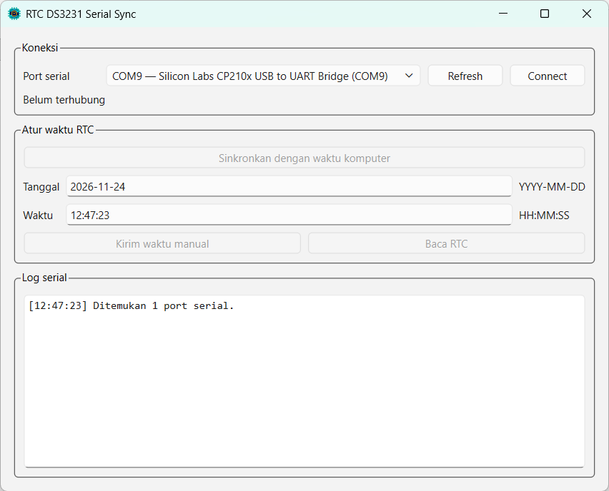
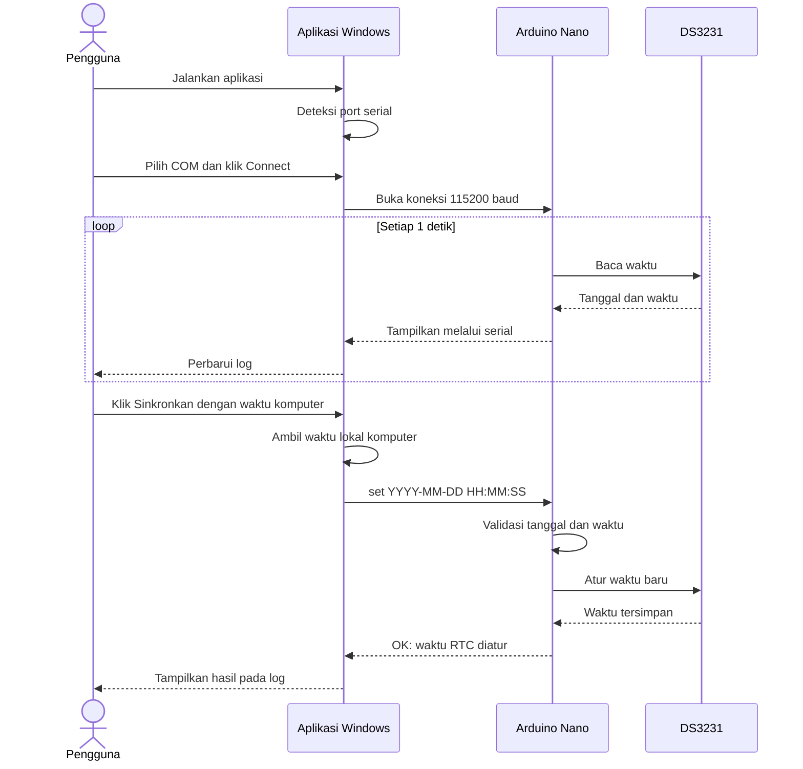

# DS3231 RTC Sync Tool

Program untuk mengatur dan membaca waktu RTC DS3231 melalui koneksi serial.
Firmware ditujukan untuk Arduino Nano ATmega328P dengan bootloader baru, sedangkan
aplikasi GUI Windows mengambil waktu lokal komputer dan mengirimkannya ke RTC.

<p align="center">
  
  <br>
  <em>Gambar 1. Aplikasi RTC DS3231 Serial Sync untuk Windows.</em>
</p>

## Fitur

- Sinkronisasi DS3231 dengan waktu lokal komputer dalam satu klik.
- Pengaturan tanggal dan waktu secara manual.
- Pembacaan waktu RTC secara langsung.
- Deteksi port serial dan log komunikasi.
- Validasi tanggal, waktu, dan tahun kabisat pada firmware.
- Aplikasi Windows mandiri tanpa perlu memasang Python.

## Perangkat yang dibutuhkan

- Arduino Nano ATmega328P (new bootloader).
- Modul RTC DS3231.
- Kabel USB dan empat kabel jumper.
- Windows 64-bit untuk menjalankan aplikasi GUI yang tersedia.

### Koneksi DS3231 ke Arduino Nano

| DS3231 | Arduino Nano |
|---|---|
| VCC | 5V |
| GND | GND |
| SDA | A4 |
| SCL | A5 |

## Cara menggunakan

1. Clone atau unduh repository ini.
2. Buka proyek menggunakan PlatformIO.
3. Hubungkan DS3231 ke Arduino Nano sesuai tabel koneksi.
4. Upload firmware:

   ```powershell
   pio run --target upload
   ```

5. Tutup Serial Monitor atau aplikasi lain yang sedang memakai port Arduino.
6. Jalankan [`dist/RTC-DS3231-Sync.exe`](dist/RTC-DS3231-Sync.exe).
7. Pilih port COM Arduino, lalu klik **Connect**.
8. Klik **Sinkronkan dengan waktu komputer**.
9. Pastikan pesan `OK: waktu RTC diatur` muncul pada log serial.

Tombol **Kirim waktu manual** dapat digunakan untuk mengirim tanggal dan waktu
yang dimasukkan pada kolom. Tombol **Baca RTC** meminta waktu RTC saat ini tanpa
mengubahnya.

## Sequence diagram



## Perintah serial

Firmware juga dapat digunakan melalui Serial Monitor pada 115200 baud.

| Perintah | Fungsi |
|---|---|
| `set YYYY-MM-DD HH:MM:SS` | Mengatur tanggal dan waktu RTC |
| `now` | Membaca waktu RTC saat ini |
| `help` | Menampilkan daftar perintah |

Contoh:

```text
set 2026-11-24 11:16:02
```

## Struktur proyek

```text
.
├── assets/                Icon EXE dan icon transparan untuk jendela
├── docs/images/           Screenshot untuk dokumentasi
├── dist/                  Aplikasi Windows siap pakai
├── src/
│   ├── main.cpp           Integrasi Arduino, RTClib, dan serial
│   ├── rtc_commands.c     Parser dan validasi perintah
│   └── rtc_commands.h     Antarmuka modul perintah
├── tools/
│   ├── rtc_gui.py         Source aplikasi GUI
│   └── build_gui.ps1      Skrip build executable
└── platformio.ini         Konfigurasi Arduino Nano
```

`main.cpp` tetap menggunakan C++ karena RTClib menyediakan antarmuka berbasis
class. Parser dan validasi yang tidak bergantung pada RTClib dipisahkan ke dalam
modul C murni.

## Membangun aplikasi GUI

Executable di dalam folder `dist` sudah siap digunakan. Untuk membangunnya
kembali dari source:

```powershell
python -m pip install pyserial pyinstaller PySide6-Essentials
powershell -ExecutionPolicy Bypass -File tools\build_gui.ps1
```

Hasil build akan tersedia sebagai `dist\RTC-DS3231-Sync.exe`.

## Lisensi

Belum ada lisensi yang ditetapkan. Semua hak tetap dimiliki oleh pemilik
repository sampai sebuah file lisensi ditambahkan.
